# Light-Triggered BJT LED Circuit


An LED that turns on when my phone's screen lights up, built from one NPN transistor, a photoresistor, and three resistors. No microcontroller and no code. When the screen turns on, the photoresistor (LDR) picks up the light, a voltage divider drives a PN2222 into saturation, and a white LED comes on. With the screen on, about 5.5 mA goes through the LED. With the screen off, the transistor circuit itself only draws about 5 µA (the breadboard power module draws a lot more than that on its own).

I have to be up before sunrise for AFROTC PT. My [first alarm](https://github.com/jmcalister-eee/light-triggered-arduino-lamp-alarm) used an Arduino to read a photoresistor and switch a lamp through a relay. It works, but an Arduino is a lot of hardware for "turn on when it gets bright." So, I tried doing the light-sensing part with a single transistor and resistor values worked out by hand. The LED is a small-scale stand-in for the lamp.

<p align="center">
  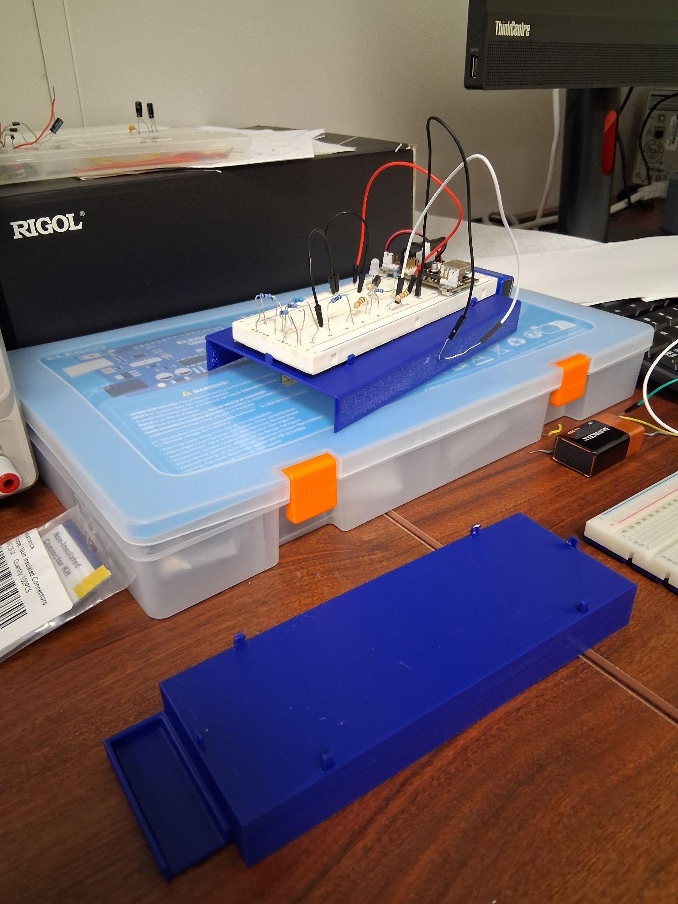
</p>

<table>
  <tr>
    <td align="center" width="33%">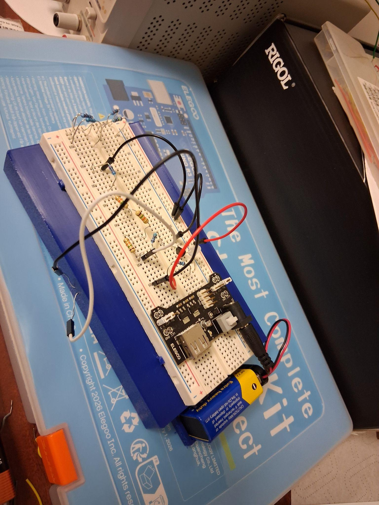<br><sub>Circuit in the enclosure</sub></td>
    <td align="center" width="33%">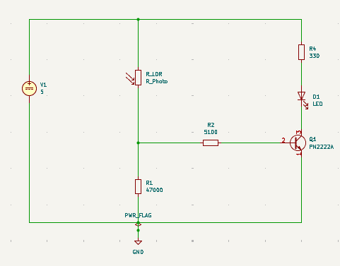<br><sub>Schematic (KiCad)</sub></td>
    <td align="center" width="33%"><br><sub>Enclosure (Fusion 360)</sub></td>
  </tr>
</table>

[Demo video](docs/videos/demo.mp4) | [Presentation (PDF)](docs/slideshow/finished_slideshow_BJT_LED_project.pdf) | [Full schematic sheet (SVG)](hardware/schematic.svg)

## How it works

The photoresistor and R1 make a voltage divider. When the phone screen turns on, the LDR's resistance drops, the voltage at node A goes up, and current flows through R_B into the base of Q1. Depending on how much light hits the LDR, the transistor is in one of three regions:

| Region | R_LDR (test value) | What's happening | LED |
|---|---|---|---|
| Off (cutoff) | About 1 MΩ (dark, screen off) | Node A is around 0.22 V, well under the ~0.65 V needed to turn on the base-emitter junction | Off |
| Active | About 100 kΩ (dim light) | Base-emitter is on, and collector current is roughly β times the base current | Dim |
| Saturated | About 26 kΩ (dark room, phone screen on) | There's more base current than the LED needs. V_CE drops to about 0.1 V and Q1 acts like a closed switch. | Full brightness |

I designed for the saturated case: about 6 mA through the LED when the screen is on in a dark room. In simulation, the active region runs from roughly 429 kΩ down to 27 kΩ.

<table>
  <tr>
    <td align="center" width="33%">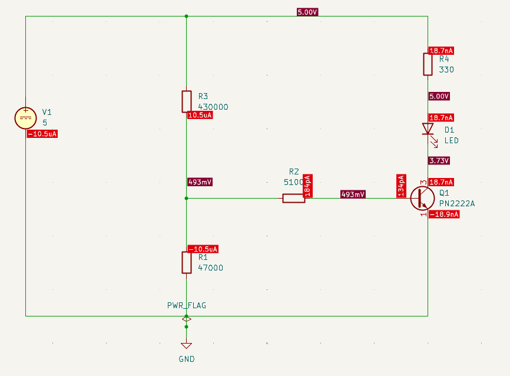<br><sub>Edge of cutoff (430 kΩ): 18.7 nA, LED off</sub></td>
    <td align="center" width="33%">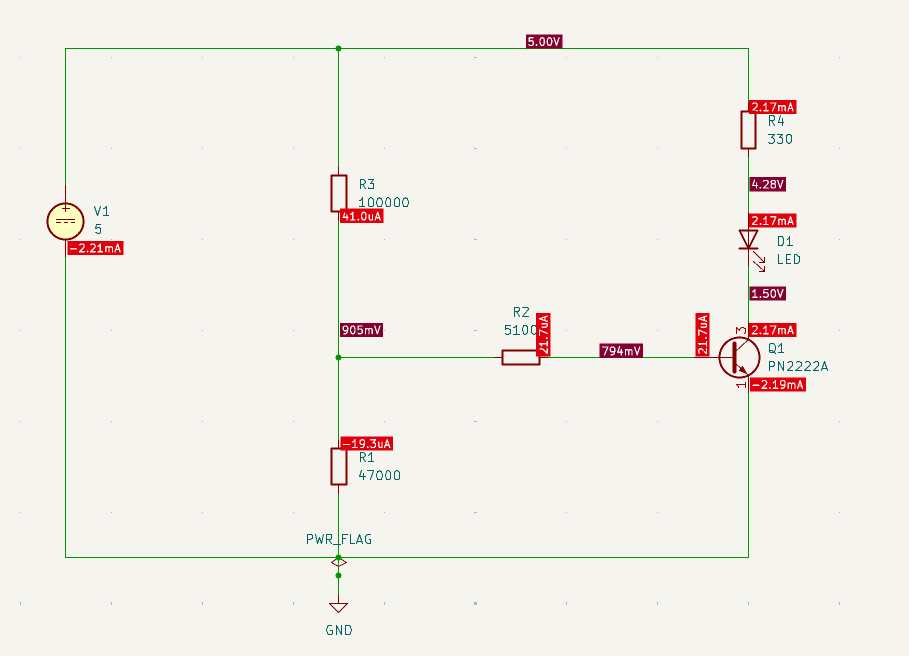<br><sub>Active (100 kΩ): 2.17 mA, LED dim</sub></td>
    <td align="center" width="33%">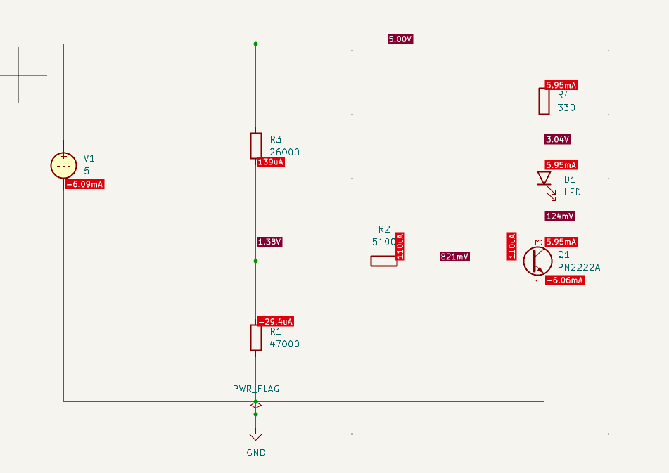<br><sub>Saturated (26 kΩ): 5.95 mA, LED full</sub></td>
  </tr>
</table>

These are KiCad (ngspice) simulations using the PN2222A model. The left one is right at the edge of cutoff, which is where I got the 430 kΩ number. The 1 MΩ results are under [Results](#results).

## Hardware

### Schematic

The schematic is shown at the top. The KiCad project is in [`hardware/kicad/`](hardware/kicad/), and the full sheet is [`hardware/schematic.svg`](hardware/schematic.svg).

The photoresistor is simulated as a 26 kΩ resistor in the KiCad file, since that's the case I designed around. To see the other regions, change its simulation value to `100k` or `1Meg`. Use `Meg` and not `M`, because SPICE reads `M` as milli.

### Parts list

| Ref | Qty | Part | Notes |
|---|---|---|---|
| Q1 | 1 | PN2222 NPN transistor, TO-92 | Modeled with the PN2222A datasheet and SPICE model |
| R_LDR (R3) | 1 | Photoresistor (LDR) | About 26 kΩ with the phone screen on in a dark room. On female-to-male jumpers so it can sit against the screen. |
| R1 | 1 | 47 kΩ | Made from three 15 kΩ and one 2 kΩ in series |
| R2 (R_B) | 1 | 5.1 kΩ | Base resistor |
| R4 | 1 | 330 Ω | LED current limiting |
| D1 | 1 | White LED | |
| V1 | 1 | Breadboard power supply module, 5 V out | Powered from a 9 V battery with a barrel-jack lead |
| | 1 | Breadboard | |
| | | Jumper wires, female-to-male jumpers | |
| | 1 | 3D-printed enclosure (v1.4) | See [Enclosure](#enclosure) |

For testing, I swapped the LDR for fixed 100 kΩ and 1 MΩ resistors and a potentiometer set to 26 kΩ so each region would hold steady while I measured.

### Wiring

| From | To |
|---|---|
| 5 V rail | R_LDR pin 1, R4 pin 1 |
| R_LDR pin 2 | Node A |
| R1 | Node A to GND |
| R2 (R_B) | Node A to Q1 base |
| R4 pin 2 | D1 anode |
| D1 cathode | Q1 collector |
| Q1 emitter | GND |

PN2222 / PN2222A pinout (TO-92): with the flat side facing you and the legs pointing down, it's E, B, C from left to right. Check your part's datasheet, since not every TO-92 transistor uses that order.

### Enclosure

I designed the housing in Fusion 360 and 3D-printed it. It holds the breadboard and the 9 V battery, and the holes on the side are for the photoresistor. The current version is v1.4.

<p align="center">
  
</p>

Files in [`hardware/enclosure/`](hardware/enclosure/):

| File | Use |
|---|---|
| `.f3d` | Fusion 360 source |
| `.stl` | Mesh for any slicer |
| `.3mf` | Base project file |
| `H2D_*` / `X2D_*` `.gcode.3mf` | Pre-sliced plates for Bambu Lab H2D and X2D printers, PLA and PETG |

## Design math

My full work is in the hand calculations below and the [calculation spreadsheet](analysis/spreadsheet/).

**1. Pick the LED current and β.** I wanted about 6 mA through the LED when saturated. The PN2222A datasheet lists h_FE (β) as at least 50 at 1 mA and 75 at 10 mA (both at V_CE = 10 V), so I went with β = 60 for 6 mA. That puts the base current at 6 mA / 60 = 100 µA.

**2. Size the LED resistor (R4).** Using KVL around the collector loop, with about 2.9 V across the white LED and 0.1 V across the saturated transistor, that leaves 2.0 V for R4. 2.0 V / 6 mA is about 333 Ω, so I used a standard 330 Ω.

**3. Solve node A with KCL** (R_LDR = 26 kΩ, R1 = 47 kΩ). The current through the LDR splits between R1 and the 100 µA going into the base. Solving for node A gives V_A ≈ 1.545 V.

**4. Find the largest base resistor that still delivers 100 µA** (V_BE ≈ 0.65 V). That leaves 1.545 V − 0.65 V = 0.895 V across R_B, and 0.895 V / 100 µA gives R_B,max = 8.95 kΩ. I picked R_B = 5.1 kΩ, well under the max. The extra base current is margin in case the real β is lower than 60.

**5. Rough turn-on point.** Q1 starts to turn on once node A gets to about 0.65 V. Using just the R_LDR / R1 divider, that happens around 315 kΩ. That estimate ignores base current. In simulation, Q1 starts leaving cutoff once R_LDR drops below about 430 kΩ. The LED doesn't visibly light until well below that, and Q1 is fully saturated below about 27 kΩ.

**Changing it:** a bigger R1 makes it trigger in dimmer light, and a smaller R1 needs more light. A smaller R4 makes the LED brighter (stay under the LED's rating and recheck R_B). For a different supply voltage, redo steps 2 through 4.

<details>
<summary>Hand calculations, page 1: β, R4, and the node A equation</summary>

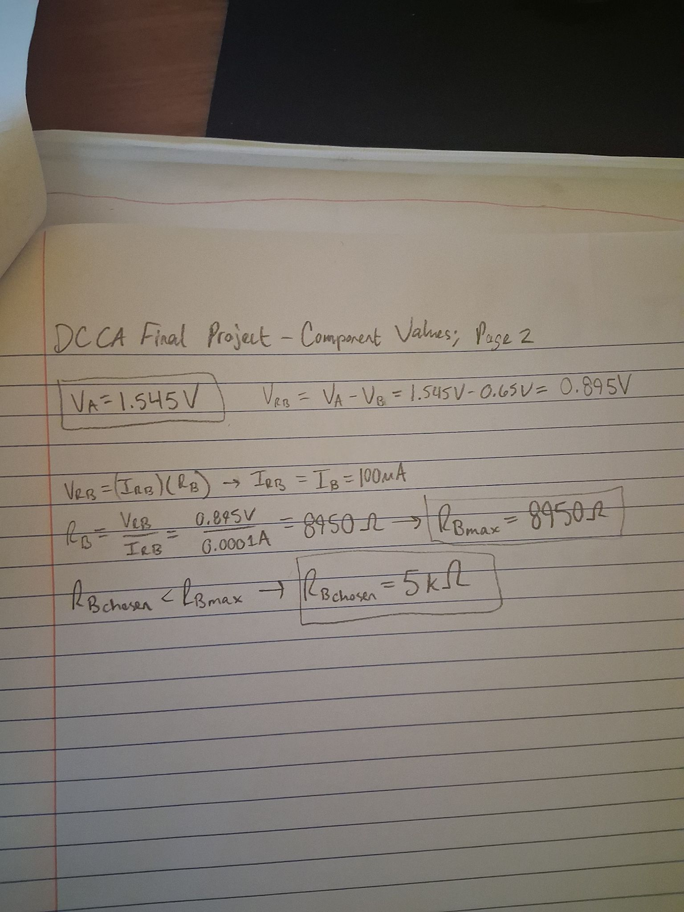

</details>

<details>
<summary>Hand calculations, page 2: V_A and choosing R_B</summary>


</details>

<details>
<summary>Hand-drawn circuit</summary>

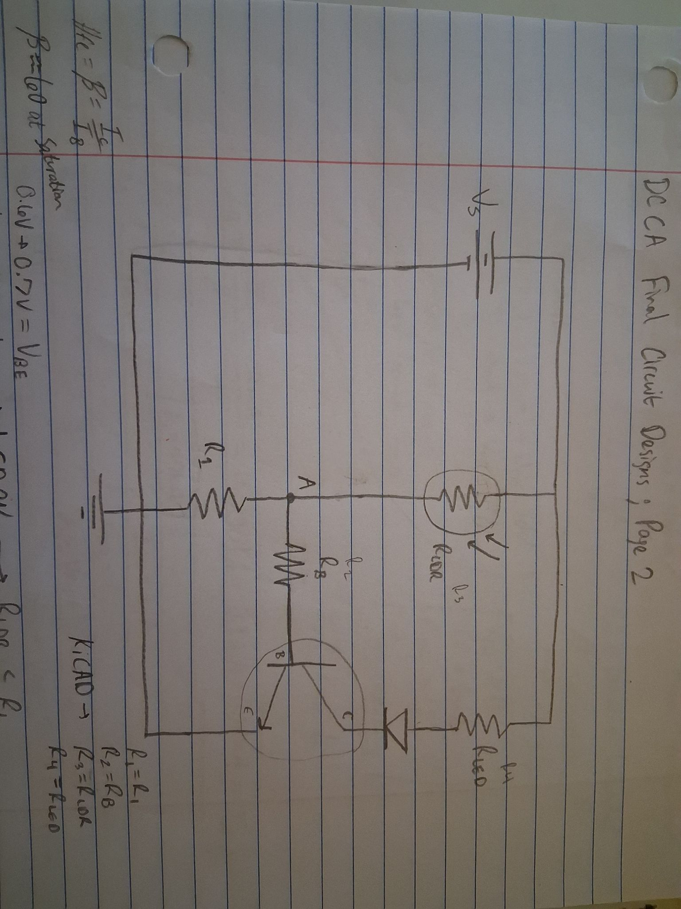

</details>

## Results

I measured each region with a multimeter on the breadboard build. For these tables I swapped the LDR out for fixed resistors (and a potentiometer for 26 kΩ) so the readings wouldn't drift with the room lighting. The [demo video](docs/videos/demo.mp4) shows the real thing triggering off a phone screen with the actual photoresistor. Hand calculations, simulation, and measurements are side by side below.

### Saturated: dark room, phone screen on (R_LDR = 26 kΩ)

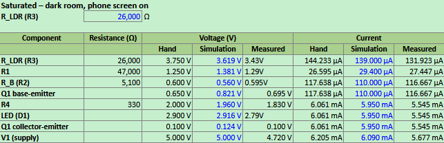

### Active: dim light (R_LDR = 100 kΩ)

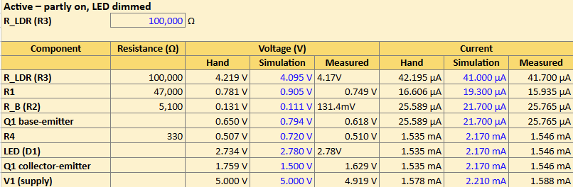

### Off: phone screen off (R_LDR = 1 MΩ)

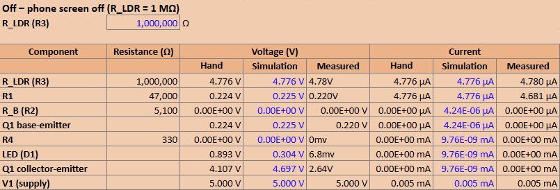

### What I took away from the numbers

- My β (beta) = 60 estimate was close. In the active region I measured 1.546 mA of collector current and 25.765 µA of base current, which works out to about 60. That's at 1.5 mA though, not my 6 mA design point, since you can't really measure β once the transistor is saturated.
- The saturated case really is saturated. The measured ratio there is 5.545 mA / 116.667 µA ≈ 47.5, which is below the active-region β, and V_CE measured 0.10 V.
- LED current came in about 8.5% low (5.545 mA measured vs. 6.061 mA by hand). Most of that is the supply sagging to 4.72 V under load. The LED also dropped a little less than I assumed (2.79 V instead of 2.90 V), so R4 ended up with 1.83 V instead of 2.00 V, and 1.83 V / 330 Ω ≈ 5.55 mA.
- The simulation overshoots the active-region current (2.17 mA vs. 1.55 mA measured). KiCad's PN2222A model acts like β ≈ 100 (2.17 mA / 21.7 µA), while my actual transistor measured about 60. The model's V_BE is also higher than the 0.65 V I assumed by hand.
- The off-state V_CE reading (2.64 V measured vs. 4.697 V simulated) is probably the meter, not the circuit. With Q1 off, the collector node is barely connected to anything, so the multimeter itself (usually around 10 MΩ input) pulls the reading down. The currents were all basically zero, so the circuit was definitely off.

## Design notes and what I learned

- **A transistor instead of a microcontroller.** For a single "on when bright" threshold, one transistor and a divider are enough.
- **LDR on the top half of the divider.** With the LDR between 5 V and node A, more light means more base voltage, so light turns the LED on. Flipping the two would do the opposite.
- **47 kΩ from series resistors.** I used three 15 kΩ and a 2 kΩ that I already had instead of waiting on a 47 kΩ. Feel free to use a single 47 kΩ, though.
- **Fixed resistors for testing.** I used fixed resistors for more accurate results when testing specific resistance values.

The β (beta / h_FE / collector current to base current ratio) value was the hardest part of this project, because it isn't one number you can just look up:

- The only datasheet I could find was for the PN2222A, a newer, higher-rated version of the PN2222 I actually used.
- That datasheet gives h_FE at V_CE = 10 V, not 5 V, and the range is wide. I picked β = 60, between the 1 mA and 10 mA values.
- β is only roughly constant in the active region. It changes with collector current, it doesn't mean anything in cutoff, and in saturation the I_C / I_B ratio is set by the circuit instead of the transistor.
- R_B depends directly on β. Since β changes from part to part and with temperature, I chose R_B well under the max (5.1 kΩ vs. 8.95 kΩ) to overdrive the base. The measured ratio of about 47.5 shows that worked.

<details>
<summary>The datasheet values I used for β</summary>

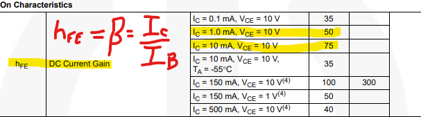

*From the onsemi PN2222A datasheet, "On Characteristics" table ([source](https://www.onsemi.com/pdf/datasheet/pn2222a-d.pdf)). Annotations are mine.*

| I_C | V_CE | h_FE (min) |
|---|---|---|
| 1.0 mA | 10 V | 50 |
| 10 mA | 10 V | 75 |

</details>

What I'd keep in mind next time:
- Design around a low β (beta) value, so the transistor still saturates if your part's β is worse than expected, and check saturation by measuring V_CE. My project could have gone much faster if I'd known to start here.
- Treat simulation models as a starting point. Simulated components can behave differently from the values you calculate around, and knowing that could have saved me a huge headache. The model's β of around 100 vs. my part's 60 is a good example of why you build and measure.
- Measure the supply under load. The supply sagged 0.28 V, which explained most of my LED current error.

## Limitations and next steps

- There's no hysteresis or delay. The Arduino version waited 10 seconds and used separate on and off thresholds. This one reacts instantly, so room lights or daylight can set it off, and light levels near the threshold leave the LED dim instead of cleanly on or off.
- The threshold is fixed by the resistors, so changing sensitivity means swapping R1.
- The LDR's resistance depends on the phone, the screen brightness, and the room. My 26 kΩ design value was measured in a dark room.

Ideas for later:
- Use this transistor stage to drive the lamp relay from the [Arduino version](https://github.com/jmcalister-eee/light-triggered-arduino-lamp-alarm), so the lamp alarm works without any code.
- Add hysteresis for a clean on/off point.
- Add an RC delay so a quick flash of light doesn't trigger it.
- Move it off the breadboard onto perfboard or a custom PCB.

Overall, I consider the project a success. It works as a proof of concept that one transistor can handle the light-sensing part of my lamp alarm without a microcontroller, which was my main goal.

## Build it yourself

1. Get the parts in the [parts list](#parts-list).
2. Wire it up using the schematic and [wiring table](#wiring). Double-check the transistor pinout.
3. Set the breadboard power module to 5 V, then plug in the 9 V battery.
4. In a dark room, hold the photoresistor against a phone screen. The LED should come on when the screen does.
5. If it triggers too easily or not at all, adjust R1 (see the end of [Design math](#design-math)).
6. Optionally, print the enclosure from [`hardware/enclosure/`](hardware/enclosure/). The photoresistor goes in the holes on the side.

## Repository layout

```
bjt-light-triggered-led-circuit/
├── analysis/
│   ├── hand_calculations/        # Scanned hand calculations and the β reference
│   ├── kicad_simulation_images/  # KiCad operating points for each region
│   └── spreadsheet/              # Calculation spreadsheet and results tables
├── docs/
│   ├── images/                   # Photos, enclosure renders, schematic image
│   ├── slideshow/                # Final presentation (PDF)
│   └── videos/                   # Demo video
└── hardware/
    ├── kicad/                    # KiCad 10 project (schematic and simulation)
    ├── enclosure/                # Fusion 360 source, STL, 3MF, pre-sliced print files
    └── schematic.svg             # Full schematic sheet
```

## Credits and license

Shoutout to Cooper for helping me take measurements. Transistor data is from the [onsemi PN2222A datasheet](https://www.onsemi.com/pdf/datasheet/pn2222a-d.pdf).

Released under the [MIT License](LICENSE).
